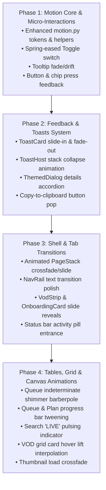

# Qt GUI Animations Upgrade Plan

Status: Done in v2.1.0

This document provides a comprehensive analysis of the current animation architecture in LuckyTwitch Downloader, an exhaustive inventory of existing animations and static candidate elements, design system tokens for motion, and a structured phased implementation roadmap.

---

## 1. Executive Summary & Objective

- **Goal:** Upgrade the motion and micro-interaction experience across the entire LuckyTwitch Qt 6 / PySide6 user interface to deliver a modern, fluid, and responsive feel.
- **Architectural Tenet:** **Strict Accessibility & Test Determinism.** All animations must respect `Motion.enabled()` and Windows OS `SPI_GETCLIENTAREAANIMATION` settings. When disabled (or in headless test suites), all motion durations collapse to zero and transitions resolve synchronously, ensuring that the 707+ Qt test suite remains fast and 100% deterministic.
- **Performance Budget:** Zero layout thrashing; repaint animations using high-efficiency `update()` schedules; avoid memory leaks or Shiboken invalid pointer crashes during widget teardown.

---

## 2. Current State Audit & Limitations

The current animation infrastructure resides primarily in `qt_ui/motion.py` and a few isolated custom widgets:

| Component | File Reference | Current Mechanism | Limitations & Pain Points |
| :--- | :--- | :--- | :--- |
| **`Toggle` switch** | `qt_ui/widgets.py` | `QPropertyAnimation` over `position` (70 ms) | • Default linear easing (feels stiff and robotic).<br>• Does not consult `Motion.enabled()` / `Motion.duration()`.<br>• No knob squish/stretch on toggle; track hover colour does not tween smoothly. |
| **`Collapsible`** | `qt_ui/widgets.py` | `animate_height` on `body` (180 ms `OutCubic`) | • Header arrow glyph jumps instantly (`▸` ↔ `▾`) with no rotation.<br>• Body maximum height resets abruptly to `QWIDGETSIZE_MAX` on completion, causing layout reflow jumps. |
| **`NavRail`** | `qt_ui/shell.py` | `animate_width` (46 px ↔ 134 px, 180 ms `OutCubic`) | • Labels immediately flip between compact badge and full text while width is tweening, resulting in momentary text clipping.<br>• Active indicator bar snaps instantly. |
| **`MarqueeLabel`** | `qt_ui/widgets.py` | 30 FPS `QTimer` linear offset (35 px/s) | • Fixed 30 FPS can stutter on 60 Hz/120 Hz/144 Hz displays.<br>• Hard text edges instead of smooth alpha-fade masks at the overflow boundaries. |
| **`Timeline` shimmer** | `qt_ui/timeline.py` | 40 ms `QTimer` (`SHIMMER_STEP = 0.03`) | • Basic linear phase translation across placeholder boxes when storyboard frames are loading. |
| **`ButtonHoverAnimator`** | `qt_ui/motion.py` | `QVariantAnimation` color interpolator (120 ms) | • Written as an experimental spike in Phase 9a, but currently completely unused across the codebase. |

---

## 3. Inventory of Static Elements That Should Be Animated

### A. Feedback, Toasts & Overlays
1. **Toast Notifications (`qt_ui/toast.py`):**
   - **Entry:** `card.show()` currently snaps cards onto screen without entry motion. *Target:* Smooth slide-in from the right + opacity fade-in (180 ms `OutCubic`).
   - **Exit / Dismiss:** `card.hide()` snaps cards away. *Target:* Slide-out to the right + opacity fade-out (140 ms `InCubic`).
   - **Stack Repositioning:** When a toast is closed, remaining cards abruptly jump up with `card.move()`. *Target:* Animated vertical translation (`QPropertyAnimation(b"pos")`, 160 ms `OutQuad`) smoothly collapsing the stack gap.
2. **Tooltips (`qt_ui/widgets.py`):**
   - Tooltip bubbles pop in and disappear abruptly after 450 ms delay. *Target:* 80 ms subtle fade-in + 3 px upward drift (`InQuad`/`OutQuad`).
3. **Modal Dialogs & Expandable Details (`qt_ui/dialogs.py`):**
   - "Show details" / "Hide details" in `ThemedDialog` abruptly calls `details_edit.setVisible(visible)`. *Target:* Smooth accordion expansion with `animate_height` and chevron rotation.
   - Dialog backdrop fade-in when opened.

### B. Shell & Layout Navigation
1. **Page Switching (`qt_ui/shell.py` - `PageStack`):**
   - Switching between Search, Plan, Options, and Queue instantly swaps widgets via `QStackedWidget`. *Target:* A silky, high-performance crossfade or subtle horizontal directional slide + fade (150 ms `OutCubic`), giving a polished modern app feel.
2. **Loaded VOD Strip (`qt_ui/shell.py`):**
   - Appears/disappears via `setVisible(True)` / `setVisible(False)` (48 px tall). *Target:* Smooth slide-down reveal (`animate_height` 0 → 48 px) and slide-up collapse when cleared.
3. **Top Command Bar & Inline Action Button (`qt_ui/shell.py`):**
   - The inline "Paste" ↔ "✕" button abruptly flips text. *Target:* Quick crossfade/scale pop.
   - Account status dot (`○` ↔ `●`) snaps state. *Target:* Pulsing transition or glowing ring on authentication.
4. **Bottom Status Bar & Activity Pill (`qt_ui/main_window.py`):**
   - `activity_pill` ("Job 1/3", "45%") snaps visible/hidden. *Target:* Slide-up/fade-in pill entrance; smooth width adjustment when text changes.
   - `shellProgress` (3 px top bar): Value jumps instantly. *Target:* Smooth progress tweening.

### C. Tables, Lists & Item Delegates
1. **Queue Table Progress Bars (`qt_ui/tabs/queue.py`):**
   - **Indeterminate state (`progress < 0`):** Currently renders a completely static 35% gray chunk. *Target:* An animated looping barberpole / shimmer wave sliding continuously across the track.
   - **Determinate progress updates:** Value snaps from chunk to chunk. *Target:* Smooth progress interpolation so the bar glides forward.
2. **Search Streamer List & "LIVE" Marker (`qt_ui/search_models.py`):**
   - The red "LIVE" badge is completely static (`#eb0400`). *Target:* A pulsing dot or subtle glowing breathing effect (sinusoidal alpha oscillation 60–100% over 1200 ms) giving a live broadcast feel.
3. **VOD Grid Cards (`qt_ui/search_models.py`):**
   - Card hover lift is currently an instant discrete 1 px adjustment (`lift = -1.0 if hovered else 0.0`). *Target:* Continuous interpolated hover elevation (0 px → 2 px lift with subtle border brightness tween).
4. **Thumbnail Image Pop-in (`qt_ui/tabs/search.py`):**
   - Streamer avatars and VOD thumbnails pop in abruptly from gray boxes when downloaded. *Target:* 120 ms alpha crossfade when the pixmap replaces the placeholder.

### D. Plan Tab & Timeline Controls
1. **Onboarding Banner (`qt_ui/tabs/plan.py`):**
   - Snaps visible/hidden (`setVisible(src is None)`). *Target:* Accordion collapse / reveal transition.
2. **Part Cards Rebuilding (`qt_ui/tabs/plan.py`):**
   - When cut points are edited, all part cards are deleted and recreated instantly. *Target:* Smooth insertion/removal animation and staggered fade-in for new cards.
3. **Coverage Bar (`qt_ui/tabs/plan.py`):**
   - Snaps progress percentage immediately. *Target:* Value tweening.
4. **Timeline Canvas (`qt_ui/timeline.py`):**
   - **Snap Guide Feedback:** Vertical snap line appears and then hard-cuts out after timer. *Target:* Opacity fade-out.
   - **Zoom In/Out/Fit:** Viewport instantly jumps. *Target:* Smooth zoom transition (interpolating viewport `start` and `zoom` over 120 ms).

### E. Options Tab (`qt_ui/tabs/options.py`)
1. **Section Switching:**
   - Navigating between Output, Cuts, Chapters, etc. abruptly toggles visibility. *Target:* Subtle crossfade / vertical slide transition.
2. **SideNav Active Indicator:**
   - Active nav button abruptly changes background. *Target:* Animated active pill indicator or smooth background fade.
3. **Token Chips:**
   - Click feedback: Quick micro-bounce / press feedback.

---

## 4. Motion System Architecture & Design Tokens

Extend `qt_ui/motion.py` with standard motion design tokens and high-level helpers:

### Motion Tokens
```python
# Duration Tokens (ms)
DURATION_INSTANT = 0      # Used when Motion.enabled() is False
DURATION_MICRO   = 80     # Tooltip, checkbox, chip press
DURATION_FAST    = 140    # Toggle knob, button hover, dismissals
DURATION_NORMAL  = 200    # Dialogs, card expansion, tabs crossfade
DURATION_ENTER   = 240    # Toast entry, banner reveal, modal pop
DURATION_PULSE   = 1200   # "LIVE" broadcast breathing loop

# Easing Curves
EASING_OUT       = QEasingCurve.Type.OutCubic      # Standard deceleration
EASING_IN        = QEasingCurve.Type.InCubic       # Clean acceleration for exit
EASING_SNAP      = QEasingCurve.Type.OutBack       # Subtle spring/bounce for micro-interactions
EASING_SMOOTH    = QEasingCurve.Type.InOutQuad     # Smooth transitions
```

### Core Reusable Primitives
1. **`animate_opacity(widget, start_alpha, end_alpha, duration_ms, on_finished)`:**
   Uses `QGraphicsOpacityEffect` to smoothly fade in/out any widget without altering widget geometry.
2. **`animate_slide_and_fade(widget, start_pos, end_pos, start_alpha, end_alpha, duration_ms)`:**
   Parallel animation group for toasts, tooltips, and floating pills.
3. **`animate_value(parent, current_val, target_val, duration_ms, on_update, on_finished)`:**
   Generic numeric tween for progress bars, counters, and viewport zoom.
4. **`AnimatedStackedWidget`:**
   Drop-in subclass of `QStackedWidget` for `PageStack` with smooth crossfade and directional slide transitions.
5. **`ShimmerEffect` / `IndeterminatePulse`:**
   Shared, low-CPU tick-based shimmer coordinator for timeline placeholders and table progress bars.

---

## 5. Technical Feasibility & PySide6 Safety Patterns

1. **Accessibility & Test Determinism:**
   - Every animation routine will pass through `Motion.duration(token)`. When `Motion.enabled() == False` (such as during headless pytest suites or when Windows system animations are disabled), `Motion.duration()` returns `0`, immediately applying the final state and running callbacks synchronously.
2. **PySide6 / Shiboken Safety:**
   - All animations attached to C++ widgets must check `shiboken6.isValid(widget)` before accessing properties in `valueChanged` slots to prevent crashes during widget destruction or tab tear-down.
3. **60+ FPS Without Layout Thrashing:**
   - High-frequency animations (progress bars, canvas shimmer, live pulse) use `update()` (dirty-rect repaint) rather than triggering layout reflows (`layout.activate()` / `adjustSize()`).
   - Opacity animations reuse effects rather than creating orphaned `QGraphicsOpacityEffect` instances.

---

## 6. Implementation Roadmap



### Phase 1: Motion Core & Micro-Interactions
- Upgrade `qt_ui/motion.py` with standard duration tokens, easing curves, and opacity/value animators.
- Upgrade `Toggle` in `qt_ui/widgets.py` with `OutBack` easing, `Motion.enabled()` compliance, and smooth track colour interpolation.
- Upgrade `Tooltip` with subtle 80 ms fade-in and drift.
- Enhance button/chip press micro-feedback.

### Phase 2: Feedback & Notification Systems
- Upgrade `ToastCard` with slide-in and fade-out animations.
- Upgrade `ToastHost` with smooth vertical repositioning when dismissing toasts.
- Upgrade `ThemedDialog` details expansion to smooth accordion animation with chevron rotation.
- Add micro-animations to "Copy details" and "Copy code" feedback buttons.

### Phase 3: Shell & Page Transitions
- Implement `AnimatedStackedWidget` in `qt_ui/shell.py` for smooth tab crossfade.
- Polish `NavRail` expansion to prevent label text clipping during width transition.
- Add slide-down reveal and slide-up collapse for `VodStrip` and `onboarding_card`.
- Add entrance and exit animations for the status bar `activity_pill`.

### Phase 4: Tables, Delegates & Canvas Polish
- Add an animated barberpole shimmer for indeterminate progress in the Queue table.
- Add smooth value tweening for determinate progress bars in the Queue and Plan tabs.
- Add a gentle pulsing glow / breathing animation to the red "LIVE" badge in search results.
- Implement continuous hover lift and border brightness interpolation for VOD grid cards.
- Add 120 ms alpha crossfade when thumbnails load.
