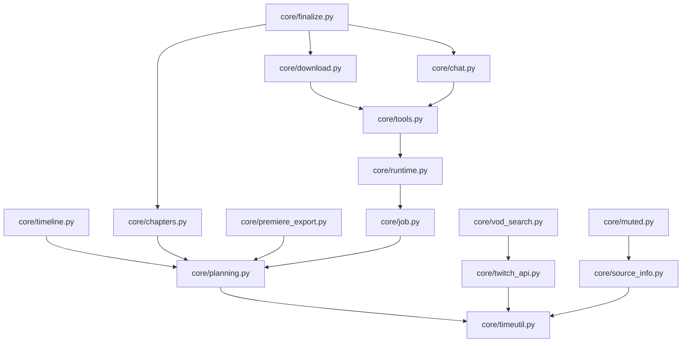

# Engine Split Blueprint & Symbol Map (Phase E)

Status: Active (Phase E blueprint for v2.5.0)

This document is the master architectural blueprint for splitting `luckytwitch_engine.py` (3,715 lines) into focused, cohesive modules under `core/` without breaking any existing behavior, external API, or test suite.

---

## 1. Principles & Architectural Invariants

1. **Zero Breaking Changes:** `luckytwitch_engine.py` remains as a facade that re-exports 100% of the 176 mapped symbols. Any code doing `from luckytwitch_engine import X` or `import luckytwitch_engine; luckytwitch_engine.X` continues working unchanged.
2. **Strict Unidirectional Dependency Flow (DAG):** Modules in `core/` must never form circular import cycles. Higher-level orchestration (`finalize`, `runtime`, `download`) imports lower-level utilities (`timeutil`, `planning`, `source_info`), never vice versa.
3. **Incremental Migration & Release per Step:** Each step (E1, E2, ...) moves one or two modules, verifies 100% test pass (`python -m pytest tests -q`), and keeps git history atomic.
4. **Safety-Net Test:** `tests/test_engine_exports.py` freezes all 176 symbols, asserting that every symbol exists on `luckytwitch_engine` and points to its callable, class, or constant.
5. **Monkeypatch Safety:** Tests patching `luckytwitch_engine.<attr>` (such as `tests/test_qt_twitch_dialog.py`) are identified up-front so their target remains patched or is safely adapted.

---

## 2. Dependency Graph (DAG)

---

## 3. Detailed Symbol & Module Split Matrix

### E1. `core/timeutil.py`
**Risk Level:** Low | **Purpose:** Time helpers & formatting | **Symbols:** 3

| Symbol | Kind | App Importers | Test Importers |
|---|---|---|---|
| `fmt_hms` | function | `main_window.py`, `search_models.py`, `shell.py`, `plan.py`, `timeline.py` | `test_time_helpers.py` |
| `parse_time` | function | *(facade only)* | `test_time_helpers.py` |
| `parse_twitch_duration` | function | *(facade only)* | `test_time_helpers.py` |

### E2. `core/planning.py`
**Risk Level:** Low | **Purpose:** Cut points, parts, planning exceptions, strategy | **Symbols:** 13

| Symbol | Kind | App Importers | Test Importers |
|---|---|---|---|
| `APP_DIR` | constant / var | `paths.py`, `settings.py`, `options.py` | *(facade only)* |
| `Cancelled` | class | `background_jobs.py`, `queue_runner.py`, `twitch_dialog.py` | `test_chat_and_game_markers.py`, `test_chat_overlay.py`, `test_qt_twitch_dialog.py` |
| `END_WORDS` | constant / var | *(facade only)* | *(facade only)* |
| `EngineError` | class | `main_window.py`, `plan.py` | `test_chat_and_game_markers.py`, `test_chat_overlay.py`, `test_qt_twitch_dialog.py`, `test_storyboard_and_segments.py` |
| `FILLER_WORDS` | constant / var | *(facade only)* | *(facade only)* |
| `Part` | class | `examples.py` | `test_chat_overlay.py`, `test_naming.py`, `test_planning.py` |
| `Plan` | class | *(facade only)* | *(facade only)* |
| `PlanError` | class | *(facade only)* | `test_chapters.py`, `test_cut_editing.py`, `test_planning.py`, `test_time_helpers.py` |
| `choose_strategy` | function | *(facade only)* | `test_planning.py` |
| `insert_cut_point` | function | `plan.py` | `test_planning.py` |
| `make_plan` | function | `main_window.py`, `plan.py`, `queue_demo.py` | `test_planning.py` |
| `parse_cut_points` | function | *(facade only)* | `test_cut_editing.py`, `test_planning.py` |
| `split_groups` | function | *(facade only)* | `test_planning.py` |

### E3. `core/timeline.py`
**Risk Level:** Low | **Purpose:** Timeline slice editing, edges, and ranges (merges into existing) | **Symbols:** 13

| Symbol | Kind | App Importers | Test Importers |
|---|---|---|---|
| `Edge` | class | `timeline.py` | `test_cut_editing.py` |
| `MIN_PART` | constant / var | *(facade only)* | `test_cut_editing.py` |
| `Range` | function | `timeline.py`, `plan.py`, `timeline.py`, `make_showcase_banner.py` | *(facade only)* |
| `add_cut` | function | `timeline.py` | `test_cut_editing.py` |
| `edges_of` | function | `timeline.py` | `test_cut_editing.py` |
| `isolate_span` | function | `timeline.py` | `test_cut_editing.py` |
| `move_edge` | function | `timeline.py` | `test_cut_editing.py` |
| `nearest_edge` | function | `timeline.py` | `test_cut_editing.py` |
| `part_index_at` | function | `timeline.py` | `test_cut_editing.py` |
| `ranges_of` | function | `plan.py` | `test_cut_editing.py` |
| `ranges_to_text` | function | `plan.py` | `test_cut_editing.py` |
| `remove_cut` | function | `timeline.py` | `test_cut_editing.py` |
| `toggle_part` | function | `plan.py`, `timeline.py` | `test_cut_editing.py` |

### E4. `core/twitch_api.py`
**Risk Level:** Medium | **Purpose:** Twitch API client & Device Code Flow OAuth | **Symbols:** 11

| Symbol | Kind | App Importers | Test Importers |
|---|---|---|---|
| `API_URL` | constant / var | *(facade only)* | *(facade only)* |
| `DEVICE_GRANT` | constant / var | *(facade only)* | `test_qt_twitch_dialog.py` |
| `DEVICE_URL` | constant / var | *(facade only)* | `test_qt_twitch_dialog.py` |
| `TOKEN_URL` | constant / var | *(facade only)* | `test_qt_twitch_dialog.py` |
| `TWITCH_CLIENT_ID` | constant / var | `config.py` | `test_qt_twitch_dialog.py` |
| `TwitchClient` | class | `config.py`, `twitch_dialog.py` | `test_qt_twitch_dialog.py` |
| `clip_end` | function | *(facade only)* | *(facade only)* |
| `clip_start` | function | `plan.py` | `test_chapters.py` |
| `device_login_poll` | function | `twitch_dialog.py` | *(facade only)* |
| `device_login_start` | function | `twitch_dialog.py` | *(facade only)* |
| `fetch_clips_for_vod` | function | `background_jobs.py` | *(facade only)* |

### E5. `core/vod_search.py`
**Risk Level:** Low | **Purpose:** Streamer channel search & VOD listing | **Symbols:** 4

| Symbol | Kind | App Importers | Test Importers |
|---|---|---|---|
| `VIDEO_TYPES` | constant / var | *(facade only)* | *(facade only)* |
| `fetch_thumbnail` | function | `search.py`, `thumbs.py` | *(facade only)* |
| `fetch_videos` | function | `search.py` | *(facade only)* |
| `search_channels` | function | `search.py` | *(facade only)* |

### E6. `core/chapters.py`
**Risk Level:** Low | **Purpose:** Clips, game chapters, muted chapters & ffmetadata | **Symbols:** 13

| Symbol | Kind | App Importers | Test Importers |
|---|---|---|---|
| `Chapter` | class | *(facade only)* | `test_chapters.py`, `test_chat_and_game_markers.py`, `test_muted_audio.py`, `test_premiere_plugin_json.py` |
| `ClipFilter` | class | `options.py` | `test_chapters.py` |
| `MUTED_COMMENT` | constant / var | *(facade only)* | *(facade only)* |
| `MUTED_TITLE` | constant / var | *(facade only)* | *(facade only)* |
| `_SafeDict` | class | `examples.py` | *(facade only)* |
| `chapters_for_part` | function | *(facade only)* | `test_chapters.py`, `test_chat_and_game_markers.py` |
| `clip_cut_text` | function | `main_window.py` | `test_chapters.py` |
| `ffmetadata` | function | *(facade only)* | `test_chapters.py` |
| `fill_gaps` | function | *(facade only)* | `test_chapters.py` |
| `filter_clips` | function | *(facade only)* | `test_chapters.py` |
| `game_chapters` | function | *(facade only)* | `test_chat_and_game_markers.py` |
| `make_chapters` | function | `plan.py` | `test_chapters.py` |
| `muted_chapters` | function | *(facade only)* | *(facade only)* |

### E7. `core/premiere_export.py`
**Risk Level:** Low | **Purpose:** Premiere FCP XML & .markers.json export | **Symbols:** 7

| Symbol | Kind | App Importers | Test Importers |
|---|---|---|---|
| `MARKERS_JSON_FORMAT` | constant / var | *(facade only)* | *(facade only)* |
| `MARKERS_JSON_VERSION` | constant / var | *(facade only)* | *(facade only)* |
| `premiere_markers_json` | function | *(facade only)* | `test_muted_audio.py`, `test_premiere_plugin_json.py` |
| `premiere_markers_xml` | function | *(facade only)* | `test_chapters.py`, `test_chat_and_game_markers.py` |
| `probe_video` | function | *(facade only)* | *(facade only)* |
| `write_markers_json` | function | *(facade only)* | *(facade only)* |
| `write_premiere_xml` | function | *(facade only)* | *(facade only)* |

### E8. `core/source_info.py`
**Risk Level:** Medium | **Purpose:** yt-dlp metadata extraction, formats, storyboards | **Symbols:** 19

| Symbol | Kind | App Importers | Test Importers |
|---|---|---|---|
| `GameSegment` | class | `examples.py`, `timeline.py`, `plan.py`, `timeline.py`, `make_showcase_banner.py` | `test_chat_and_game_markers.py`, `test_naming.py`, `test_premiere_plugin_json.py`, `test_qt_timeline.py`, `test_storyboard_and_segments.py` |
| `QUALITY_AUDIO` | constant / var | *(facade only)* | `test_quality_formats.py` |
| `QUALITY_BEST` | constant / var | `plan.py` | `test_quality_formats.py` |
| `SourceInfo` | class | `examples.py`, `make_showcase_banner.py`, `qt_screenshots.py` | `test_chat_overlay.py`, `test_naming.py`, `test_qt_plan_tab.py` |
| `Storyboard` | class | `plan.py`, `timeline.py` | `test_qt_timeline.py`, `test_storyboard_and_segments.py` |
| `VideoFormat` | class | `examples.py` | `test_naming.py`, `test_quality_formats.py` |
| `YTDLP_MISSING` | constant / var | *(facade only)* | *(facade only)* |
| `describe_quality` | function | *(facade only)* | *(facade only)* |
| `estimate_bytes` | function | `plan.py` | `test_quality_formats.py` |
| `fetch_storyboard_sheet` | function | *(facade only)* | `test_storyboard_and_segments.py` |
| `get_source_info` | function | `background_jobs.py`, `make_showcase_banner.py`, `queue_demo.py` | *(facade only)* |
| `load_storyboard_frames` | function | `background_jobs.py`, `make_showcase_banner.py` | `test_storyboard_and_segments.py` |
| `normalize_url` | function | *(facade only)* | `test_source_and_progress.py` |
| `parse_formats` | function | *(facade only)* | `test_quality_formats.py` |
| `parse_game_segments` | function | *(facade only)* | `test_storyboard_and_segments.py` |
| `parse_source_info` | function | *(facade only)* | `test_quality_formats.py`, `test_storyboard_and_segments.py` |
| `parse_storyboard` | function | *(facade only)* | `test_storyboard_and_segments.py` |
| `resolve_format` | function | `plan.py` | `test_quality_formats.py` |
| `twitch_vod_id` | function | *(facade only)* | `test_source_and_progress.py` |

### E9. `core/muted.py`
**Risk Level:** Low | **Purpose:** HLS playlist muted segment detection & overlap | **Symbols:** 5

| Symbol | Kind | App Importers | Test Importers |
|---|---|---|---|
| `fetch_muted_ranges` | function | *(facade only)* | *(facade only)* |
| `muted_from_playlist_url` | function | *(facade only)* | *(facade only)* |
| `muted_overlap` | function | `plan.py` | *(facade only)* |
| `parse_muted_ranges` | function | *(facade only)* | *(facade only)* |
| `pick_playlist_url` | function | *(facade only)* | *(facade only)* |

### E10. `core/job.py`
**Risk Level:** Low | **Purpose:** Job & JobOptions dataclasses | **Symbols:** 2

| Symbol | Kind | App Importers | Test Importers |
|---|---|---|---|
| `Job` | class | `main_window.py`, `queue_demo.py` | *(facade only)* |
| `JobOptions` | class | `examples.py`, `options.py`, `background_jobs.py`, `queue_demo.py` | `test_chat_overlay.py`, `test_naming.py` |

### E11. `core/runtime.py`
**Risk Level:** Medium | **Purpose:** Ctx context, logging, progress, process management | **Symbols:** 7

| Symbol | Kind | App Importers | Test Importers |
|---|---|---|---|
| `Ctx` | class | `background_jobs.py`, `queue_runner.py`, `queue_demo.py` | `test_chat_and_game_markers.py`, `test_chat_overlay.py`, `test_mp4_timescale.py`, `test_naming.py` |
| `EXE` | constant / var | *(facade only)* | *(facade only)* |
| `TOOLS_DIR` | constant / var | `options.py` | *(facade only)* |
| `USER_AGENT` | constant / var | `updates.py` | *(facade only)* |
| `find_tool` | function | *(facade only)* | *(facade only)* |
| `kill_process_tree` | function | *(facade only)* | *(facade only)* |
| `user_data_dir` | function | `paths.py` | *(facade only)* |

### E12. `core/tools.py`
**Risk Level:** Medium | **Purpose:** External tool management (yt-dlp, ffmpeg, tdcli) | **Symbols:** 16

| Symbol | Kind | App Importers | Test Importers |
|---|---|---|---|
| `FFMPEG_BUILDS` | constant / var | *(facade only)* | *(facade only)* |
| `TDCLI_REPO` | constant / var | *(facade only)* | *(facade only)* |
| `TDCLI_VERSION` | constant / var | *(facade only)* | *(facade only)* |
| `YTDLP_RELEASES` | constant / var | *(facade only)* | *(facade only)* |
| `_download_file` | function | `updates.py` | *(facade only)* |
| `describe_tools` | function | `background_jobs.py` | *(facade only)* |
| `ensure_tdcli` | function | `background_jobs.py` | *(facade only)* |
| `ensure_tools` | function | `background_jobs.py`, `queue_demo.py` | *(facade only)* |
| `find_tdcli` | function | *(facade only)* | *(facade only)* |
| `install_ffmpeg` | function | *(facade only)* | *(facade only)* |
| `install_tdcli` | function | *(facade only)* | *(facade only)* |
| `install_ytdlp` | function | *(facade only)* | *(facade only)* |
| `installed_ytdlp_version` | function | *(facade only)* | *(facade only)* |
| `latest_ytdlp_tag` | function | *(facade only)* | *(facade only)* |
| `pick_tdcli_asset` | function | *(facade only)* | `test_chat_and_game_markers.py` |
| `tdcli_dir` | function | *(facade only)* | *(facade only)* |

### E13. `core/download.py`
**Risk Level:** High | **Purpose:** HLS/segmented/full downloading & ffmpeg processing | **Symbols:** 24

| Symbol | Kind | App Importers | Test Importers |
|---|---|---|---|
| `AUDIO_FORMATS` | constant / var | *(facade only)* | *(facade only)* |
| `AUDIO_SKIPPED` | constant / var | *(facade only)* | *(facade only)* |
| `FfmpegProgress` | class | *(facade only)* | *(facade only)* |
| `HLS_USER_AGENT` | constant / var | *(facade only)* | *(facade only)* |
| `MEDIA_EXTS` | constant / var | *(facade only)* | *(facade only)* |
| `MP4_MOVIE_TIMESCALE` | constant / var | *(facade only)* | `test_mp4_timescale.py` |
| `PROGRESS_TEMPLATE` | constant / var | *(facade only)* | *(facade only)* |
| `Segment` | class | *(facade only)* | *(facade only)* |
| `audio_codec_args` | function | *(facade only)* | *(facade only)* |
| `audio_only_options` | function | *(facade only)* | *(facade only)* |
| `audio_out_container` | function | *(facade only)* | *(facade only)* |
| `download_full` | function | *(facade only)* | *(facade only)* |
| `download_section` | function | *(facade only)* | *(facade only)* |
| `download_section_aligned` | function | *(facade only)* | *(facade only)* |
| `get_playlist_url` | function | *(facade only)* | *(facade only)* |
| `mp4_flags` | function | *(facade only)* | `test_mp4_timescale.py` |
| `mp4_movie_timescale` | function | *(facade only)* | `test_mp4_timescale.py` |
| `parse_ffmpeg_stats` | function | *(facade only)* | `test_source_and_progress.py` |
| `parse_hls_playlist` | function | *(facade only)* | *(facade only)* |
| `parse_progress` | function | *(facade only)* | `test_source_and_progress.py` |
| `run_ffmpeg` | function | *(facade only)* | *(facade only)* |
| `run_ytdlp` | function | *(facade only)* | *(facade only)* |
| `select_segments` | function | *(facade only)* | *(facade only)* |
| `write_local_playlist` | function | *(facade only)* | *(facade only)* |

### E14. `core/chat.py`
**Risk Level:** Medium | **Purpose:** TwitchDownloaderCLI chat download & video overlay rendering | **Symbols:** 26

| Symbol | Kind | App Importers | Test Importers |
|---|---|---|---|
| `CHAT_FORMATS` | constant / var | `options.py`, `options.py` | *(facade only)* |
| `CHAT_RENDER_EXT` | constant / var | *(facade only)* | *(facade only)* |
| `CHAT_RENDER_LABELS` | constant / var | *(facade only)* | *(facade only)* |
| `CHAT_RENDER_LOOKS` | constant / var | `options.py` | *(facade only)* |
| `CHAT_RENDER_MODES` | constant / var | `options.py` | `test_chat_overlay.py` |
| `ChatFileInfo` | class | *(facade only)* | *(facade only)* |
| `PART_VIDEO_EXTS` | constant / var | *(facade only)* | *(facade only)* |
| `chat_base_name` | function | *(facade only)* | `test_chat_overlay.py` |
| `chat_command` | function | *(facade only)* | `test_chat_and_game_markers.py` |
| `chat_files_for_part` | function | *(facade only)* | `test_chat_overlay.py` |
| `chat_lead_from_markers` | function | *(facade only)* | `test_chat_overlay.py` |
| `chat_overlay_settings` | function | *(facade only)* | *(facade only)* |
| `chat_render_command` | function | *(facade only)* | `test_chat_overlay.py` |
| `chat_render_fps` | function | *(facade only)* | `test_chat_overlay.py` |
| `chat_render_output_args` | function | *(facade only)* | `test_chat_overlay.py` |
| `chat_render_size` | function | *(facade only)* | `test_chat_overlay.py` |
| `describe_chat_overlay` | function | `main_window.py` | `test_chat_overlay.py` |
| `download_chat` | function | *(facade only)* | `test_chat_and_game_markers.py` |
| `existing_chat_overlay_path` | function | *(facade only)* | `test_chat_overlay.py` |
| `find_part_video` | function | *(facade only)* | `test_chat_overlay.py` |
| `parse_render_status` | function | *(facade only)* | `test_chat_overlay.py` |
| `parse_tdcli_status` | function | *(facade only)* | `test_chat_and_game_markers.py` |
| `read_chat_info` | function | *(facade only)* | `test_chat_overlay.py` |
| `render_chat` | function | *(facade only)* | `test_chat_overlay.py` |
| `render_existing_chat` | function | `background_jobs.py` | `test_chat_overlay.py` |
| `tdcli_error` | function | *(facade only)* | `test_chat_and_game_markers.py` |

### E15. `core/finalize.py`
**Risk Level:** High | **Purpose:** Part finalize, naming, audio extraction & job orchestrator | **Symbols:** 13

| Symbol | Kind | App Importers | Test Importers |
|---|---|---|---|
| `clean_title` | function | `main_window.py`, `plan.py` | `test_naming.py` |
| `cut_exact` | function | *(facade only)* | *(facade only)* |
| `date_components` | function | *(facade only)* | `test_naming.py` |
| `dominant_game` | function | *(facade only)* | `test_naming.py` |
| `finalize_audio_part` | function | *(facade only)* | *(facade only)* |
| `finalize_part` | function | *(facade only)* | `test_mp4_timescale.py`, `test_naming.py` |
| `format_duration_tag` | function | *(facade only)* | `test_naming.py` |
| `part_stem` | function | `examples.py` | `test_naming.py` |
| `run_job` | function | `queue_runner.py` | *(facade only)* |
| `safe_name` | function | *(facade only)* | `test_naming.py` |
| `split_copy` | function | *(facade only)* | *(facade only)* |
| `stream_dir` | function | `examples.py`, `queue.py` | `test_naming.py` |
| `unique_path` | function | *(facade only)* | `test_naming.py` |

---

## 4. Monkeypatching & Special Test Handling

The test suite uses monkeypatching on `luckytwitch_engine` in the following locations:

1. **`tests/test_qt_twitch_dialog.py:353`:** `monkeypatch.setattr(engine, "time", ...)`
   - *Action:* `luckytwitch_engine` must retain `import time` at module level, so `engine.time` continues to be patchable as-is.
2. **`tests/test_qt_twitch_dialog.py:365, 507`:** `monkeypatch.setattr(engine.requests, "post", ...)`
   - *Action:* `luckytwitch_engine` must retain `import requests` at module level, so `engine.requests.post` continues to be patchable as-is.

---

## 5. Phased Rollout Schedule

| Step | Target Module | Description | Verification |
|---|---|---|---|
| **E0** | `docs/ENGINE_SPLIT_MAP.md`, `tests/test_engine_exports.py` | Create blueprint & freeze 176 exports | `pytest tests/test_engine_exports.py` passes |
| **E1** | `core/timeutil.py` | Extract time helpers (`parse_time`, `fmt_hms`, etc.) | Full test suite green |
| **E2** | `core/planning.py` | Extract cut points and plan models | Full test suite green |
| **E3** | `core/timeline.py` | Extract/merge timeline slice and edge operations | Full test suite green |
| **E4** | `core/twitch_api.py` | Extract TwitchClient & Device Code OAuth | Full test suite green |
| **E5** | `core/vod_search.py` | Extract channel search and video fetchers | Full test suite green |
| **E6** | `core/chapters.py` | Extract clips, chapters, ffmetadata | Full test suite green |
| **E7** | `core/premiere_export.py` | Extract XML and .markers.json export | Full test suite green & CEP test green |
| **E8** | `core/source_info.py` | Extract SourceInfo, formats, storyboards | Full test suite green |
| **E9** | `core/muted.py` | Extract HLS muted segments logic | Full test suite green |
| **E10** | `core/job.py` | Extract Job and JobOptions models | Full test suite green |
| **E11** | `core/runtime.py` | Extract Ctx, logging, process termination | Full test suite green |
| **E12** | `core/tools.py` | Extract tool installers & runners (yt-dlp, ffmpeg, tdcli) | Full test suite green |
| **E13** | `core/download.py` | Extract download engines (HLS, sections, full, timescale) | Full test suite green |
| **E14** | `core/chat.py` | Extract chat downloader & video overlay renderer | Full test suite green |
| **E15** | `core/finalize.py` | Extract part finalize, naming & job coordinator | Full test suite green |
| **E16** | Facade review & v2.5.0 tag | Verify `luckytwitch_engine.py` is pure facade under 150 lines | Full test suite green & release notes |
